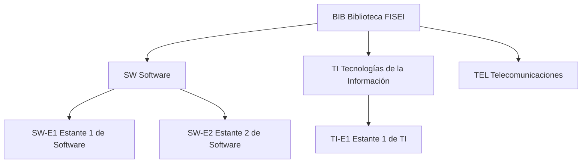
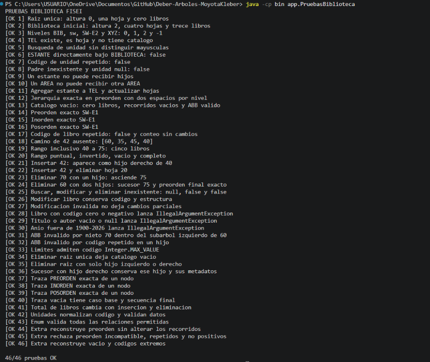

# Catálogo de la Biblioteca FISEI con árbol general y ABB en Java

**Estudiante:** Moyota Chávez Kleber Andrés  
**Universidad:** Universidad Técnica de Ambato  
**Carrera:** Ingeniería de Software  
**Asignatura:** Estructura de Datos  
**Nivel y paralelo:** Tercero B  
**Modalidad:** Individual

## Descripción del problema

La Biblioteca FISEI necesita representar sus áreas y estantes y administrar los libros
de cada estante. La aplicación utiliza un árbol general n-ario para la jerarquía
`BIBLIOTECA → AREA → ESTANTE` y un árbol binario de búsqueda (ABB) por estante,
ordenado por el código positivo y único de sus libros.

Las búsquedas, inserciones, conteos, recorridos, eliminaciones y validaciones de los árboles
se implementan con recursividad. El menú utiliza `Scanner` para ingresar los datos.

## Estructura inicial



| Estante | Códigos en orden de inserción |
| --- | --- |
| SW-E1 | 60, 35, 80, 20, 45, 70, 90, 40, 75 |
| SW-E2 | 15, 10, 25 |
| TI-E1 | 50 |

La biblioteca inicial contiene **7 unidades, 4 hojas, altura de 2 aristas y 13 libros**.
TEL también es una hoja, porque no tiene hijos, aunque sea una unidad AREA.
Los títulos, autores y años de los libros iniciales son datos de ejemplo.

## Organización del proyecto

| Paquete dentro de src | Clases |
| --- | --- |
| enums | TipoUnidad.java, TipoRecorrido.java |
| modelo | Libro.java, UnidadBiblioteca.java |
| negocio | NodoUnidad.java, NodoLibro.java, ArbolBiblioteca.java, CatalogoABB.java |
| app | Main.java, DatosPrueba.java, PruebasBiblioteca.java |

Solo las unidades ESTANTE tienen un CatalogoABB. Los códigos de unidad se guardan en
mayúsculas y se buscan sin distinguir mayúsculas y minúsculas. La jerarquía y los códigos
repetidos se validan antes de agregar una unidad.

Libro exige código mayor que cero, título y autor no vacíos y año entre 1900 y 2026.
El código es inmutable. Una modificación valida todos los datos antes de aplicarlos.

## Compilación y ejecución en Visual Studio Code

Se necesita un **JDK de Java 8 o superior**. No se requieren librerías externas.

1. Abrir en VS Code la carpeta del repositorio que contiene `src`.
2. Abrir **Terminal → Nueva terminal**.
3. Verificar que estén disponibles el ejecutor y el compilador:

```powershell
java -version
javac -version
```

4. Compilar desde la raíz del proyecto:

```powershell
javac -encoding UTF-8 -d bin src/enums/*.java src/modelo/*.java src/negocio/*.java src/app/*.java
```

5. Ejecutar las pruebas automáticas:

```powershell
java -cp bin app.PruebasBiblioteca
```

6. Ejecutar el menú:

```powershell
java -cp bin app.Main
```

La carpeta `bin` se genera durante la compilación. `.gitignore` excluye esta carpeta y los
archivos `.class` del repositorio.

## Uso del programa

Al iniciar, la biblioteca tiene únicamente la raíz BIB. La opción **1** carga la estructura
inicial y restablece sus datos. Los cambios de libros se conservan en memoria durante esa
ejecución; al cerrar y abrir el programa hay que volver a cargar e ingresar los datos.

| Opciones | Función |
| --- | --- |
| 1 y 2 | Cargar los datos iniciales y mostrar la jerarquía |
| 3 y 4 | Agregar y buscar unidades |
| 5 | Consultar altura, hojas, total de libros y nivel |
| 6, 7, 8 y 9 | Insertar, buscar, modificar y eliminar libros de un estante |
| 10 | Mostrar preorden, inorden o posorden con su traza |
| 11 | Contar códigos en un rango inclusivo, con poda |
| 12 | Mostrar el camino de búsqueda de un código |
| 13 | Validar todo el ABB mediante límites mínimo y máximo |
| 14 | Ejecutar las pruebas automáticas en estructuras independientes |
| 15 | Extra: reconstruir un catálogo a partir de su preorden |
| 0 | Salir |

La traza indica `entra X`, `VISITA X` y `null -> regresa`, con dos espacios por nivel y una
línea final con la secuencia. El inorden se obtiene por el recorrido recursivo del ABB.

Al eliminar un nodo con dos hijos se utiliza el sucesor inorden: el menor del subárbol
derecho. Los retos y la reconstrucción desde preorden también son recursivos. La
reconstrucción consume los códigos mediante límites, sin insertarlos uno a uno; genera
metadatos descriptivos de ejemplo porque su entrada contiene únicamente códigos.

Si un código no existe, el camino de búsqueda contiene los nodos examinados hasta llegar a
una referencia vacía. `contarEnRango(a, b)` incluye ambos extremos y devuelve cero si a > b.

## Pruebas y resultados

La clase PruebasBiblioteca obtuvo el siguiente resumen:

```text
46/46 pruebas OK
```



| Caso comprobado | Resultado |
| --- | --- |
| Solo raíz | Altura 0, una hoja y cero libros |
| Biblioteca inicial | Altura 2, cuatro hojas y trece libros |
| Nivel de BIB, sw, SW-E2 y XYZ | 0, 1, 2 y -1 |
| ESTANTE directamente bajo BIBLIOTECA | false |
| Código de unidad o libro repetido | false |
| Camino de 42 antes de insertarlo | [60, 35, 45, 40] |
| Rango de 40 a 75 antes de insertar 42 | 5 |
| Buscar, modificar y eliminar un libro inexistente | null, false y false |
| Libro con datos inválidos | IllegalArgumentException |
| Nieto fuera de los límites de su subárbol | esABBValido devuelve false |
| Reconstrucción desde un preorden válido | Conserva los recorridos del ABB |
| Reconstrucción con códigos repetidos o preorden incompatible | IllegalArgumentException |

### Recorridos iniciales de SW-E1

```text
PREORDEN: 60 35 20 45 40 80 70 75 90
INORDEN: 20 35 40 45 60 70 75 80 90
POSORDEN: 20 40 45 35 75 70 90 80 60
```

### Caso obligatorio de eliminación

Partiendo del catálogo inicial, se inserta 42 y se eliminan 20, 70 y 60 en ese orden.
Se comprueban los casos de hoja, un hijo y dos hijos.

```text
PREORDEN FINAL: 75 35 45 40 42 80 90
```

### Caso personal

Los pares de los cuatro últimos dígitos 9527 producen **95, 52 y 27**. No requieren ajustes.
Se insertan después de los nueve códigos iniciales de SW-E1.

```text
PREORDEN: 60 35 20 27 45 40 52 80 70 75 90 95
INORDEN: 20 27 35 40 45 52 60 70 75 80 90 95
POSORDEN: 27 20 40 52 45 35 75 70 95 90 80 60
```

En el árbol personal se elimina 95 como hoja, 70 como nodo con un hijo y 60 como nodo con
dos hijos. Las tres operaciones devuelven true. El preorden final y la validación son:

```text
Secuencia PREORDEN: 75 35 20 27 45 40 52 80 90
ABB valido: true
```

El desarrollo de los códigos, los diagramas Mermaid con aristas I y D, los recorridos,
la traza del preorden y la comparación de las eliminaciones están en [TRAZAS.md](TRAZAS.md).

## Control de versiones y entrega

El código se desarrolla en la rama `desarrollo`. La actividad requiere un repositorio
público llamado `Deber-Arboles-MoyotaKleber`, al menos tres commits significativos y la
integración de `desarrollo` en `main` mediante un pull request.

El PDF de evidencias se entrega en Moodle e incluye el enlace al repositorio, las capturas
de ejecución, el historial de commits, el pull request y las respuestas de reflexión.
