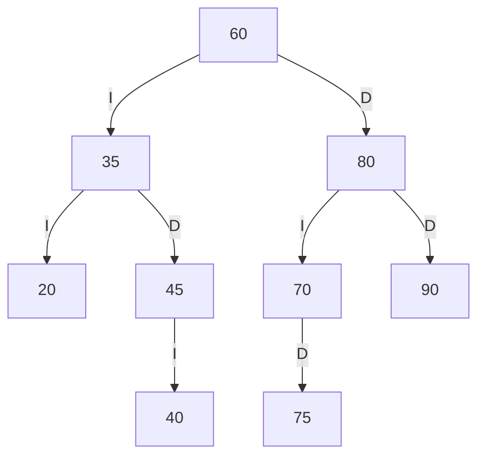
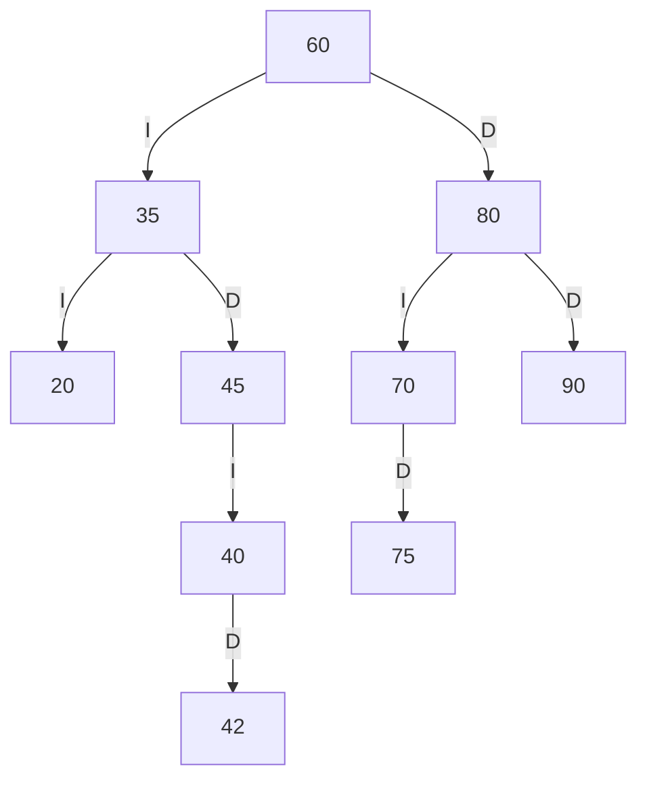
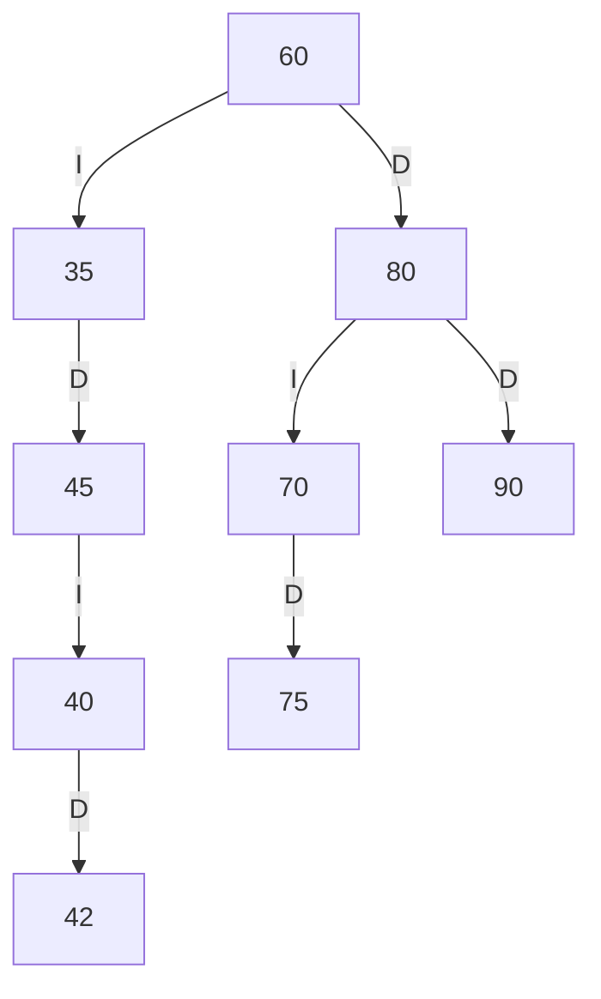
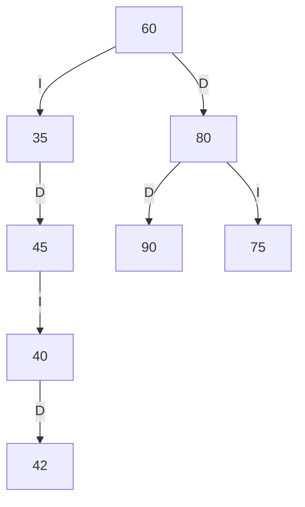
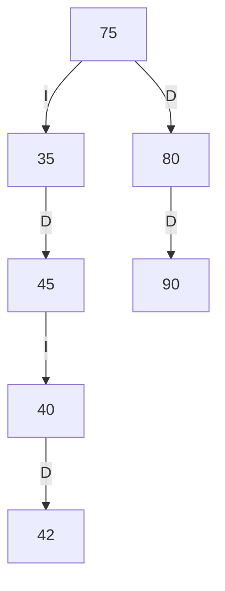
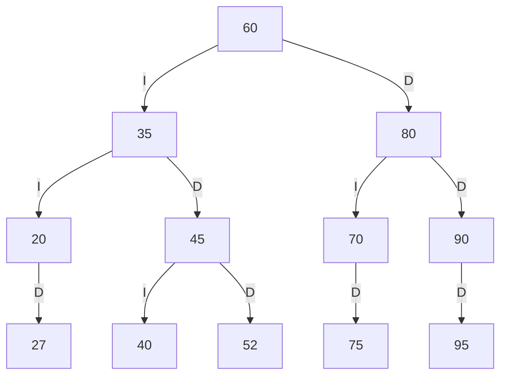
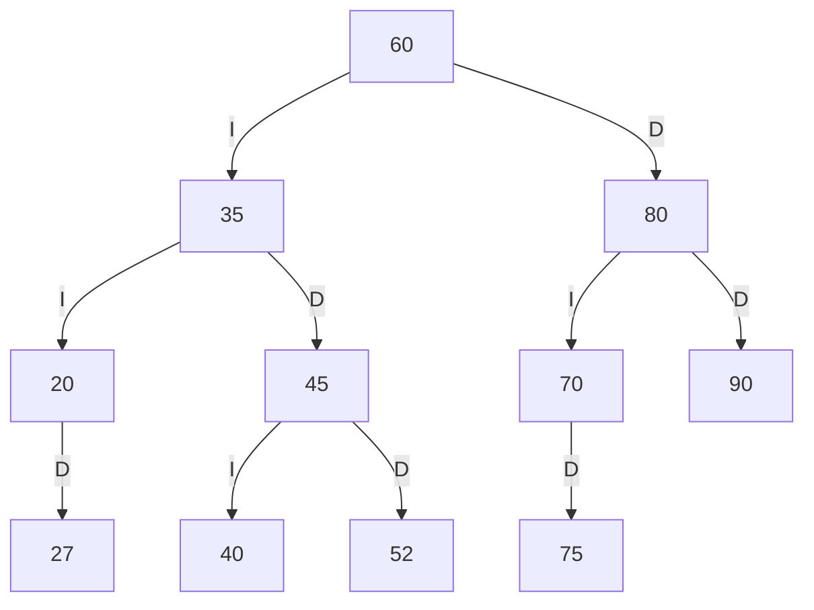
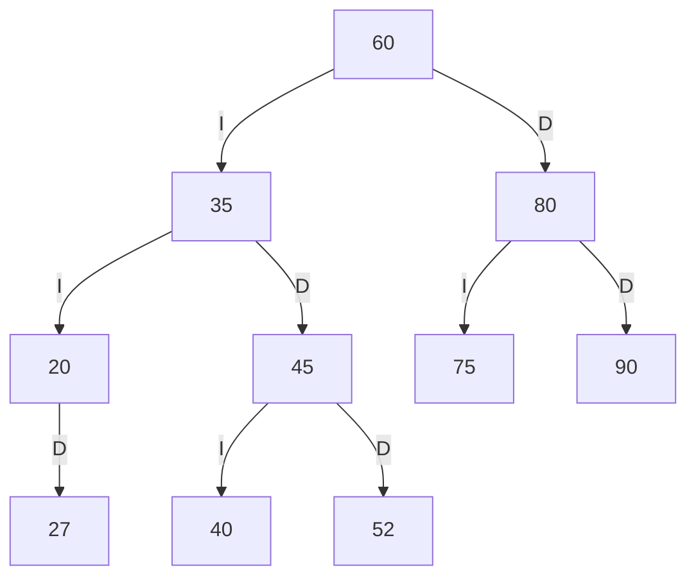
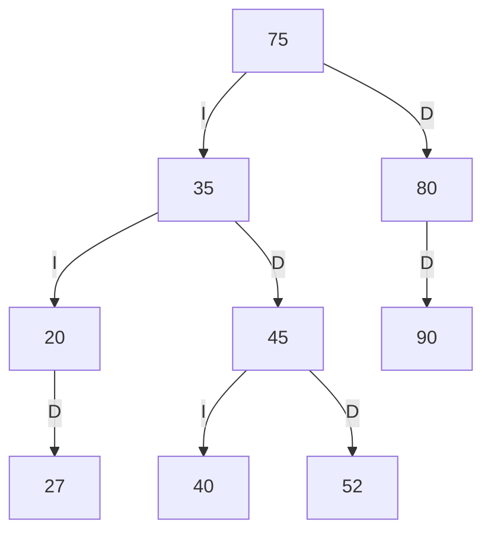

# Trazas del catálogo de la Biblioteca FISEI

**Estudiante:** Moyota Chávez Kleber Andrés.

Este documento desarrolla el caso base, las eliminaciones obligatorias del enunciado y el
caso personal con los códigos 95, 52 y 27. Cada caso parte de su propia carga inicial.
Las salidas incluidas se comprobaron ejecutando los métodos Java del proyecto.

## 1 Caso base de SW-E1

Orden de inserción: `60, 35, 80, 20, 45, 70, 90, 40, 75`.
Cada código menor se dirige a la izquierda y cada mayor a la derecha.

| Código | Comparaciones y ubicación |
| --- | --- |
| 60 | Se crea la raíz |
| 35 | 35 < 60; hijo izquierdo de 60 |
| 80 | 80 > 60; hijo derecho de 60 |
| 20 | 20 < 60 y 20 < 35; hijo izquierdo de 35 |
| 45 | 45 < 60 y 45 > 35; hijo derecho de 35 |
| 70 | 70 > 60 y 70 < 80; hijo izquierdo de 80 |
| 90 | 90 > 60 y 90 > 80; hijo derecho de 80 |
| 40 | 40 < 60, 40 > 35 y 40 < 45; hijo izquierdo de 45 |
| 75 | 75 > 60, 75 < 80 y 75 > 70; hijo derecho de 70 |



### Recorridos esperados y comprobación

| Tipo | Resultado esperado | Resultado del programa |
| --- | --- | --- |
| PREORDEN | 60 35 20 45 40 80 70 75 90 | Coincide |
| INORDEN | 20 35 40 45 60 70 75 80 90 | Coincide |
| POSORDEN | 20 40 45 35 75 70 90 80 60 | Coincide |

### Traza del preorden inicial

```text
entra 60
VISITA 60
  entra 35
  VISITA 35
    entra 20
    VISITA 20
      null -> regresa
      null -> regresa
    entra 45
    VISITA 45
      entra 40
      VISITA 40
        null -> regresa
        null -> regresa
      null -> regresa
  entra 80
  VISITA 80
    entra 70
    VISITA 70
      null -> regresa
      entra 75
      VISITA 75
        null -> regresa
        null -> regresa
    entra 90
    VISITA 90
      null -> regresa
      null -> regresa
Secuencia PREORDEN: 60 35 20 45 40 80 70 75 90
```

### Retos antes de insertar 42

- `caminoBusqueda(42)` devuelve `[60, 35, 45, 40]`. El código no existe; la búsqueda termina
  en el hijo derecho vacío de 40. No se añade `null` a la lista de códigos.
- `contarEnRango(40, 75)` devuelve `5`: códigos 40, 45, 60, 70 y 75.
- `esABBValido()` devuelve `true`.

## 2 Caso obligatorio de inserción y eliminaciones

Esta secuencia parte del SW-E1 inicial, sin insertar códigos personales.

### Insertar 42

42 < 60, 42 > 35, 42 < 45 y 42 > 40: se agrega como hijo derecho de 40.



Preorden esperado y obtenido: `60 35 20 45 40 42 80 70 75 90`. Coinciden.

### Eliminar 20 como hoja

20 no tiene hijos. La referencia izquierda de 35 pasa a `null`.



Preorden esperado y obtenido: `60 35 45 40 42 80 70 75 90`. Coinciden.

### Eliminar 70 con un hijo

70 solo tiene como hijo derecho a 75. La referencia izquierda de 80 pasa a apuntar a 75.



Preorden esperado y obtenido: `60 35 45 40 42 80 75 90`. Coinciden.

### Eliminar 60 con dos hijos

El sucesor inorden es 75, el menor del subárbol derecho. Se copia el libro completo de 75
al nodo raíz y se elimina la aparición original de 75. El código del objeto Libro no se modifica.



Preorden esperado y obtenido: `75 35 45 40 42 80 90`. Coinciden.
El catálogo queda con 7 libros y `esABBValido()` devuelve `true`.

Para repetirlas desde el menú, use las instrucciones de ejecución del README.

## 3 Desarrollo personal obligatorio

### Cálculo de los tres códigos

Cuatro últimos dígitos: **9527**. Por tanto, a = 9, b = 5, c = 2 y d = 7.

| Par | Número formado | ¿Es cero o ya existe? | Ajuste | Código final |
| --- | --- | --- | --- | --- |
| ab | 95 | No | No necesita | 95 |
| bc | 52 | No | No necesita | 52 |
| cd | 27 | No | No necesita | 27 |

Los códigos se insertan en el orden **95, 52 y 27**, después de la secuencia inicial de SW-E1.
Son positivos, distintos entre sí y no coinciden con los códigos iniciales del estante.

Secuencia completa de inserción:

```text
60, 35, 80, 20, 45, 70, 90, 40, 75, 95, 52, 27
```

### Ubicación de las inserciones personales

| Código | Camino de comparación | Ubicación |
| --- | --- | --- |
| 95 | 95 > 60, 95 > 80 y 95 > 90 | Hijo derecho de 90 |
| 52 | 52 < 60, 52 > 35 y 52 > 45 | Hijo derecho de 45 |
| 27 | 27 < 60, 27 < 35 y 27 > 20 | Hijo derecho de 20 |

### Árbol después de las tres inserciones

I representa hijo izquierdo y D representa hijo derecho.



El ABB de SW-E1 contiene **12 libros**, con raíz 60 y altura 3 aristas. Sus hojas son
27, 40, 52, 75 y 95. El árbol general conserva sus 7 unidades, altura 2 y 4 hojas;
el total de libros de toda la biblioteca pasa a 16.

### Recorridos calculados y comparación

Preorden procesa raíz, izquierda y derecha. Inorden procesa izquierda, raíz y derecha.
Posorden procesa izquierda, derecha y raíz.

| Tipo | Resultado calculado | Salida de los métodos Java | Comparación |
| --- | --- | --- | --- |
| PREORDEN | 60 35 20 27 45 40 52 80 70 75 90 95 | 60 35 20 27 45 40 52 80 70 75 90 95 | Coincide |
| INORDEN | 20 27 35 40 45 52 60 70 75 80 90 95 | 20 27 35 40 45 52 60 70 75 80 90 95 | Coincide |
| POSORDEN | 27 20 40 52 45 35 75 70 95 90 80 60 | 27 20 40 52 45 35 75 70 95 90 80 60 | Coincide |

### Traza del preorden personal

Cada nivel agrega dos espacios. Al entrar al nodo se escribe `entra`; en preorden,
`VISITA` aparece antes de recorrer los hijos. Cada hijo vacío produce `null -> regresa`.
Hay 12 visitas y 13 referencias vacías.

```text
entra 60
VISITA 60
  entra 35
  VISITA 35
    entra 20
    VISITA 20
      null -> regresa
      entra 27
      VISITA 27
        null -> regresa
        null -> regresa
    entra 45
    VISITA 45
      entra 40
      VISITA 40
        null -> regresa
        null -> regresa
      entra 52
      VISITA 52
        null -> regresa
        null -> regresa
  entra 80
  VISITA 80
    entra 70
    VISITA 70
      null -> regresa
      entra 75
      VISITA 75
        null -> regresa
        null -> regresa
    entra 90
    VISITA 90
      null -> regresa
      entra 95
      VISITA 95
        null -> regresa
        null -> regresa
Secuencia PREORDEN: 60 35 20 27 45 40 52 80 70 75 90 95
```

### Salida de las inserciones

Al ingresar cada libro en SW-E1 se obtiene `Insertar: true`. El siguiente resumen
identifica el código correspondiente a cada resultado:

```text
Insertar 95: true
Insertar 52: true
Insertar 27: true
```

Las tres inserciones coinciden con las posiciones calculadas en el árbol.

### Primera eliminación de un nodo hoja

Se elimina **95**, que no tiene hijos. El hijo derecho de 90 pasa a ser `null` y 90 se
convierte en hoja.



Resultado calculado en preorden: `60 35 20 27 45 40 52 80 70 75 90`.

Salida comprobada:

```text
Eliminar: true
Secuencia PREORDEN: 60 35 20 27 45 40 52 80 70 75 90
Libros en el catalogo SW-E1: 11
ABB valido: true
```

**Comparación:** coincide con el resultado calculado. Se conserva el orden del ABB.

### Segunda eliminación de un nodo con un hijo

Después del paso anterior se elimina **70**. Su único hijo es 75, situado a la derecha.
La referencia izquierda de 80 pasa a apuntar a 75.



Resultado calculado en preorden: `60 35 20 27 45 40 52 80 75 90`.

Salida comprobada:

```text
Eliminar: true
Secuencia PREORDEN: 60 35 20 27 45 40 52 80 75 90
Libros en el catalogo SW-E1: 10
ABB valido: true
```

**Comparación:** coincide con el resultado calculado y conserva el libro 75.

### Tercera eliminación de un nodo con dos hijos

Se elimina **60**, la raíz. Tiene como hijo izquierdo a 35 y derecho a 80.
El menor del subárbol derecho es **75**, porque se encuentra a la izquierda de 80 y no
tiene hijo izquierdo. Por ello, 75 es el sucesor inorden.

Se reemplaza el dato de la raíz con el libro de código 75 y se elimina la aparición
original de 75 del subárbol derecho. Se reemplaza la referencia al libro; no se usa
un setter del código, pues el código de Libro es inmutable.



Resultado calculado en preorden: `75 35 20 27 45 40 52 80 90`.

Salida comprobada:

```text
Eliminar: true
Secuencia PREORDEN: 75 35 20 27 45 40 52 80 90
Libros en el catalogo SW-E1: 9
ABB valido: true
```

**Comparación:** coincide. El árbol final mantiene los códigos 27 y 52, la raíz es 75
y no contiene los códigos eliminados 95, 70 y 60.

### Resumen de las tres eliminaciones personales

| Paso | Código | Caso | Reemplazo | Libros restantes en SW-E1 | Comparación |
| --- | --- | --- | --- | --- | --- |
| 1 | 95 | Hoja | null | 11 | Coincide |
| 2 | 70 | Un hijo | 75 | 10 | Coincide |
| 3 | 60 | Dos hijos | Sucesor inorden 75 | 9 | Coincide |

Después de las eliminaciones, los recorridos finales son:

```text
PREORDEN: 75 35 20 27 45 40 52 80 90
INORDEN: 20 27 35 40 45 52 75 80 90
POSORDEN: 27 20 40 52 45 35 90 80 75
```

## 4 Reproducción del caso personal desde el menú

1. Elegir la opción **1** para cargar de nuevo la biblioteca inicial. Esto restaura los
   códigos 20, 70 y 60 y descarta el libro 42 del caso anterior.
2. Usar la opción **6** en el estante **SW-E1** para insertar **95**, después **52** y
   finalmente **27**. Se pueden usar los títulos Libro 95, Libro 52 y Libro 27, autor
   Autor de prueba y año 2026.
3. Usar la opción **10**, estante SW-E1, con los tipos **1**, **2** y **3** para comprobar
   los tres recorridos personales y sus trazas.
4. Usar la opción **9**, estante SW-E1, para eliminar **95**. Consultar el preorden y
   compararlo con el primer árbol de eliminación.
5. Usar la opción **9** para eliminar **70**. Consultar el preorden y compararlo con
   el segundo árbol de eliminación.
6. Usar la opción **9** para eliminar **60**. Consultar el preorden y compararlo con
   el árbol final.
7. Usar la opción **13**, estante SW-E1: debe mostrar `ABB valido: true`.

Las cifras de libros de los pasos anteriores corresponden al catálogo SW-E1. La opción 5
muestra el total de toda la biblioteca: 16 después de las inserciones y, sucesivamente,
15, 14 y 13 después de las eliminaciones.

## 5 Verificación

La suite general obtuvo **46/46 pruebas OK**. El caso personal se comprobó adicionalmente
con los métodos de CatalogoABB: tres inserciones correctas, los tres recorridos, la traza
completa del preorden y las tres eliminaciones con sus preórdenes esperados. La validación
del ABB fue `true` después de las inserciones y después de cada eliminación.
